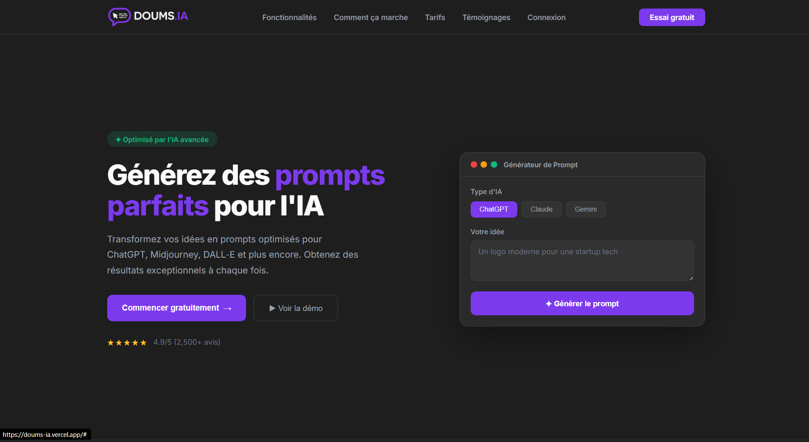

<h1 align="center">Doums IA</h1>

<p align="center">Décris ton idée en une phrase, Doums IA la transforme en prompt optimisé, prêt à coller dans ChatGPT, Claude ou Gemini.</p>

<p align="center">
  
  
  
  
  
  
  <a href="https://doums-ia.vercel.app/"></a>
</p>

<p align="center"></p>

## À propos

Bien écrire un prompt, c'est ce qui sépare une réponse moyenne d'une réponse vraiment utile. Doums IA automatise ce travail : l'utilisateur saisit une demande brute, l'application l'analyse avec Gemini, pose quelques questions si besoin, puis génère un prompt structuré (rôle, contexte, format de sortie, contraintes).

Projet personnel, conçu comme un SaaS : une landing page complète avec le générateur intégré directement dans le hero, et une API serverless déployée sur Vercel.

## Fonctionnalités

- **Analyse de la demande** : Gemini reformule en une phrase ce que l'utilisateur veut accomplir et décide si des précisions sont nécessaires.
- **Questions de clarification** : jusqu'à 3 questions ciblées générées dynamiquement quand la demande est trop vague. Si elle est claire, la génération est directe.
- **Prompt optimisé** : un méta-prompt avec checklist qualité (objectif, contexte, rôle, format, contraintes, ton) produit un prompt final sans commentaire, prêt à copier.
- **Contexte de session** : les demandes précédentes sont renvoyées à l'API pour que l'IA tienne compte de ce qui a déjà été fait.
- **Historique de session** : panneau listant les prompts générés avec leur heure, chacun copiable en un clic.
- **Copie en un clic** : bouton de copie vers le presse-papiers avec retour visuel.
- **Parcours en étapes** : saisie, questions, chargement, résultat, avec retour possible pour modifier la demande.
- **Landing page responsive** : sections fonctionnalités, fonctionnement, tarifs, menu burger sur mobile.

## Stack technique

| Côté | Technologies |
| --- | --- |
| Front | HTML, CSS, JavaScript vanilla (Fetch API, Clipboard API), police Inter |
| Back | Fonctions serverless Node.js (`api/`), Express pour le développement local |
| IA | Google Gemini (`gemini-2.5-flash`) via le SDK `@google/generative-ai` |
| Déploiement | Vercel (zero-config : `public/` en statique, `api/` en fonctions) |

## Architecture

```text
doumsIA/
├── api/
│   ├── analyze.js           # POST /api/analyze : analyse la demande, renvoie les questions
│   └── generate-prompt.js   # POST /api/generate-prompt : génère le prompt final
├── public/
│   ├── index.html           # Landing page + widget générateur
│   ├── script.js            # Logique du parcours, historique, copie
│   ├── style.css
│   └── images/
├── server.js                # Serveur Express équivalent pour le local
├── test-model.js            # Liste les modèles Gemini accessibles avec ta clé
└── vercel.json
```

- `api/` : chaque fichier est une fonction serverless Vercel, appelée par le front en chemin relatif.
- `public/` : le front statique, sans framework ni étape de build.
- `server.js` : reproduit les deux routes et sert `public/` pour travailler en local.

## Lancer le projet en local

**Prérequis** : Node.js 18 ou plus (le script `test-model.js` utilise `fetch` natif) et une clé API Google Gemini.

1. Récupère une clé gratuite sur [Google AI Studio](https://aistudio.google.com/app/apikey).
2. Installe les dépendances et crée le fichier `.env` à la racine :

```bash
git clone https://github.com/madou752/doumsIA.git
cd doumsIA
npm install
```

```env
AI_API_KEY=ta_cle
PORT=3000
```

3. Lance le serveur :

```bash
node server.js
```

L'application est disponible sur `http://localhost:3000`.

Pour vérifier que ta clé fonctionne et voir les modèles disponibles :

```bash
node test-model.js
```

Sur Vercel, ajoute `AI_API_KEY` dans les variables d'environnement du projet.

## Ce que j'ai appris

- **Faire produire du JSON fiable à un LLM** : consignes strictes dans le prompt, nettoyage des blocs markdown éventuels, puis validation du format avant de renvoyer la réponse.
- **Le méta-prompting** : écrire un prompt qui écrit des prompts, avec une checklist qualité intégrée.
- **Passer d'Express au serverless** : découper le serveur en fonctions `api/` pour Vercel, tout en gardant `server.js` pour le développement local.
- **Gérer un état sans framework** : enchaînement des étapes, historique de session et contexte envoyé à l'API, en JavaScript vanilla.

## Auteur

**Mehdi Hammadou**

[Portfolio](https://portfoliohammadoumehdi.vercel.app/) · [GitHub](https://github.com/madou752)
